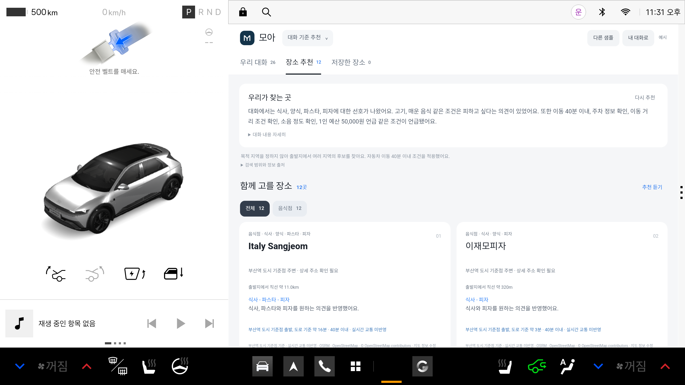
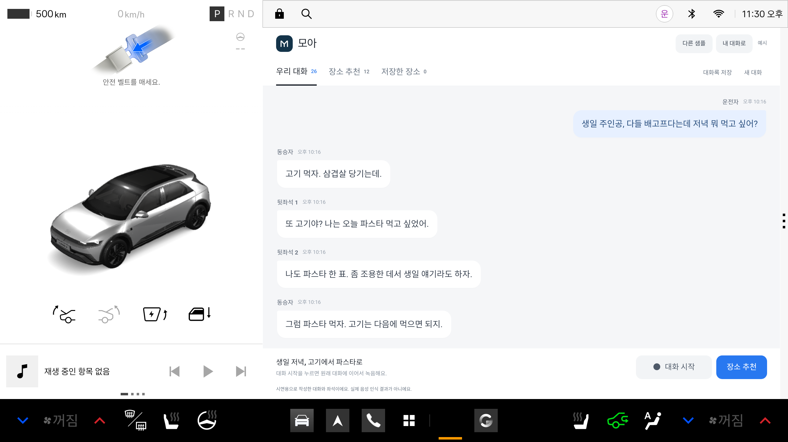
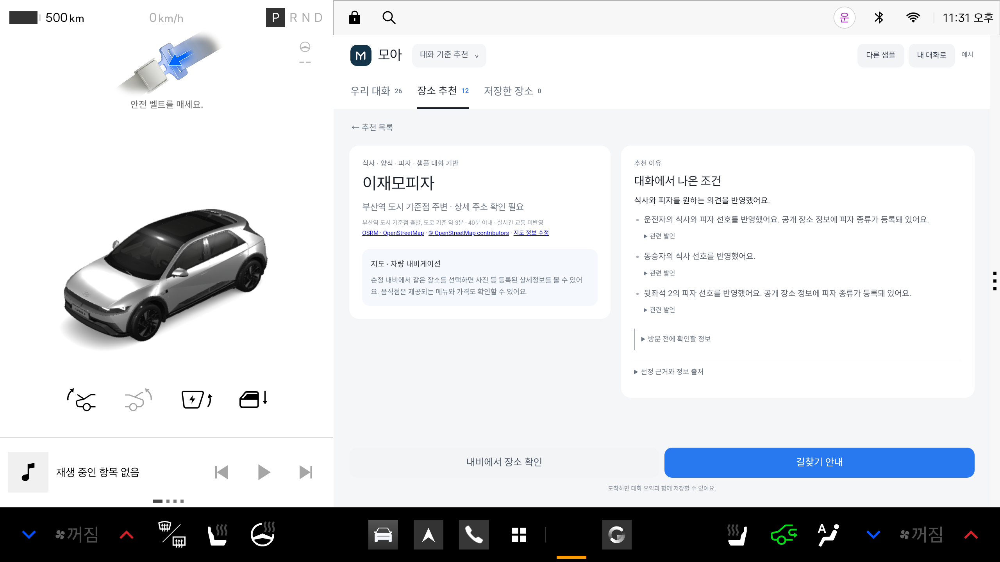
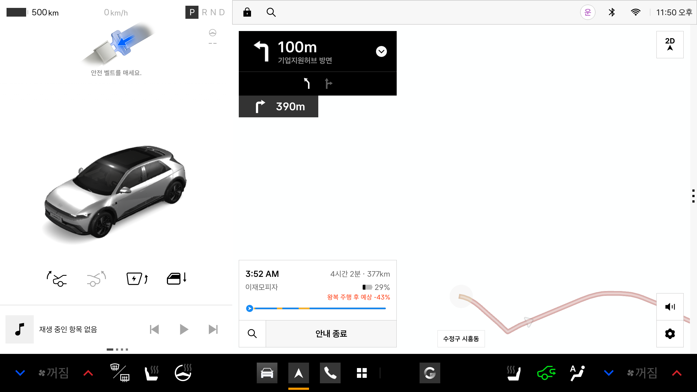
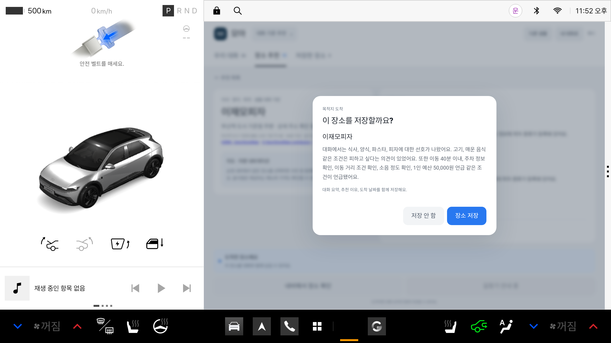
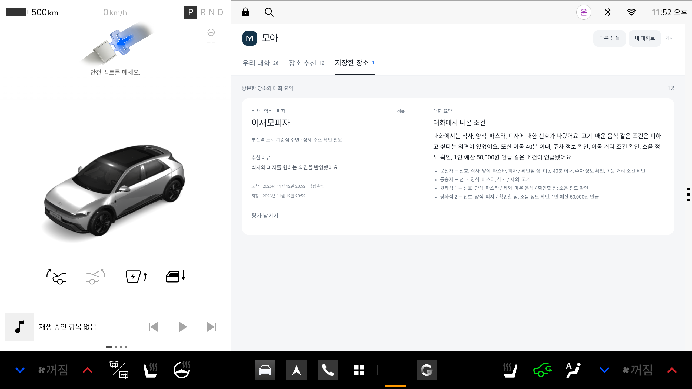

# 모아 MOA

**차 안의 대화로 함께 정하는 목적지**

모아는 탑승자들이 나눈 대화를 받아쓰고, 서로의 취향과 이동 조건에 맞는 장소를 비교하는 Pleos Connect 앱 프로토타입입니다. “바다를 보고 싶어”, “운전은 두 시간 안이면 좋겠어”, “식사는 칼국수 어때?”처럼 흩어진 의견을 모아 추천 이유와 원문을 함께 보여줍니다.

현재 버전은 **v1.6.5**입니다. Android 앱과 PC의 로컬 서버를 연결하는 개발 구성으로, 차량에서 독립 실행하는 상용 앱은 아닙니다. 대화 분석은 한국어 규칙 기반이며, Gleo가 자유 대화를 이해해 추천하는 기능까지 완성된 상태는 아닙니다.

[공개 기획서](docs/MOA_Proposal_Public.docx) · [개발 안내](docs/DEVELOPMENT.md) · [검증 기록](docs/VERIFICATION.md)

## 화면

Pleos 에뮬레이터에서 작성한 샘플 대화로 실행한 화면입니다. 개인 녹음·실제 위치를 사용한 화면이 아니며, 차량 디스플레이 원본을 캡처했습니다.



<details>
<summary>대화 기록부터 내비 안내와 저장까지 보기</summary>

**대화 기록** — 탑승자의 의견을 채팅으로 확인합니다. 좌석 표기는 시연용 예시입니다.



**장소 상세** — 추천 이유와 관련 발언을 확인한 뒤 순정 내비로 연결합니다.



**순정 내비 안내** — 길찾기 버튼으로 전환해 실제 안내를 확인했습니다. 순정 위치가 시흥동에 고정되어 가상 부산역 출발 추천과 안내 시간이 다르며, 배경 지도는 미해결입니다.



**저장 여부 선택** — 시연에서는 직접 도착 확인을 사용했습니다. 실제 주행의 자동 도착 검증을 뜻하지 않습니다.



**저장한 장소** — 동의한 샘플 장소와 선택 이유를 보관합니다.



</details>

## 주요 기능

- **대화 기록** — 음성 인식 결과를 채팅으로 표시하고, 잘못 받아쓴 문장과 좌석 표기를 수정합니다. 별도의 목소리 등록은 사용하지 않습니다.
- **조건에 맞는 여러 지역 탐색** — 대화에서 정한 출발지 또는 최신 차량 위치를 기준으로 이동 제한 안의 후보를 찾습니다. 바다뿐 아니라 식사·카페·디저트·산책·전시에도 같은 흐름을 적용합니다.
- **근거가 보이는 추천** — 대화 요약, 취향 일치 이유, 관련 발언, 방문 전 확인할 정보를 나란히 보여줍니다. 조건을 충족한 후보를 최대 12곳까지 비교합니다.
- **순정 내비 연결** — 앱 안에서 장소 상세를 먼저 확인한 뒤 순정 내비 검색·상세정보·길안내로 연결합니다.
- **방문 기록** — 도착 후 저장 여부를 묻고, 선택 당시 요약과 추천 이유를 장소와 함께 보관합니다. 개인 별점과 메모를 남길 수 있습니다.
- **시연용 대화** — 서로 다른 상황의 6개 예시를 제공합니다. 각 예시는 26발언이며 실제 대화로 돌아올 수 있습니다.

## 사용 흐름

1. **대화 시작**을 누르고 함께 갈 곳을 의논합니다. 샘플로 살펴보려면 **샘플 대화**를 선택합니다.
2. **대화 마치기** 후 받아쓴 내용을 확인하고 **장소 추천**을 누릅니다.
3. 요약과 후보를 비교하고, 장소를 눌러 상세 이유와 주소를 확인합니다.
4. **내비에서 장소 확인** 또는 **길찾기 안내**로 순정 내비를 엽니다.
5. 도착 후 **장소 저장**을 선택하면 **저장한 장소**에 남습니다. 자동 도착 정보를 받을 수 없을 때는 **직접 도착 확인**을 사용할 수 있으며 기록에 구분됩니다.

순정 내비가 열려 있는 동안 모아는 **길안내 연결 중** 알림으로 안내 상태를 확인합니다. 이 상태 추적은 마이크 녹음이나 GPS 측정을 추가로 시작하지 않습니다.

**대화록 저장**은 현재 대화를 Markdown 파일로 내보냅니다. **새 대화**는 저장한 장소와 개인 평가를 유지합니다. 실제 녹음의 확정 텍스트와 샘플은 동일한 추천 파이프라인을 사용합니다.

## 추천 방식

1. **조건 추출:** 현재 출발지와 목적지 의견, 이동 시간, 음식·활동 취향, 제외 조건, 예산 표현을 구분합니다. 지역 의견이 충돌하거나 모호하면 선택을 요청합니다.
2. **후보 수집:** 공개 OpenStreetMap 색인과 검색 서비스를 이용합니다. 목적 지역이 미정이고 이동 제한이 있으면 한 도시로 고정하지 않고 여러 방향을 탐색합니다.
3. **도로 시간 확인:** 최대 640개 후보를 검토하고, 지리적으로 분산된 최대 160개 후보의 OSRM 자동차 이동 시간을 확인합니다. 시간 초과·경로 미확인 후보로 추천 개수를 채우지 않습니다.
4. **비교와 분산:** 요청 메뉴의 등록 정보, 취향 일치, 확인된 좌석 의견, 이동 시간 여유, 개인 방문 평가를 비교합니다. 동일 브랜드와 특정 활동으로의 쏠림을 줄여 최대 12곳을 제시합니다.

등록된 메뉴 분류와 가게 이름에서 추정한 메뉴를 구분합니다. 내부 비교 점수는 **맛·인기도·외부 별점이 아닙니다.** 가격·주차·영업 여부를 확인하지 못한 경우 충족한 조건으로 표시하지 않습니다. 도로 시간은 실시간 교통을 반영하지 않으며 모든 장소를 빠짐없이 탐색하지는 않습니다.

## 구현 상태와 한계

| 항목 | 현재 범위 |
| --- | --- |
| 음성 받아쓰기 | Pleos SpeechToText 한국어 `ON_DEVICE` 우선, 오류·미지원 시 다음 대화에서 PC 로컬 음성 모델 사용. 실제 4인 대화 인식률은 미측정 |
| 좌석 자동 구분 | 미구현. 실제 녹음은 **좌석 확인 필요**로 표시하며 샘플의 4좌석은 작성된 예시 |
| Gleo 명령 | 대화 시작·추천·저장 목록의 스키마와 직접 action 실행 확인. 자연어 호출부터 앱 실행까지는 미확인 |
| Gleo와 동시 녹음 | 미지원. 시험 환경에서 Gleo가 전면에 있으면 앱 마이크 입력이 차단됨 |
| 추천 읽어주기 | 공식 TextToSpeech 연결. 실제 가청 출력과 Gleo의 자연어 답변은 별도 검증 필요 |
| 순정 내비 | 장소 검색, 길찾기 버튼의 내비 화면 전환과 실제 경로 안내 확인. **에뮬레이터의 배경 지도 누락·현재 위치 고정은 미해결** |
| 리뷰와 별점 | 개인 평가만 저장. 외부 리뷰·가게 별점·실시간 가격·영업·주차 정보는 미연결 |
| 운영 환경 | PC 로컬 서버 필요. 차량 단독 배포, 실제 주행 자동 도착, 운행 상태에 따른 화면 제한은 추가 구현·검증 필요 |

검증한 동작과 아직 확인하지 못한 항목은 [검증 기록](docs/VERIFICATION.md)에 구분했습니다.

## 실행

장소 검색용 대한민국 공개 OSM 인덱스 `data/maps/pois.sqlite`(약 45MB)를 저장소에 포함합니다. 원본 `south-korea-latest.osm.pbf`는 제외하며, 실행 시 인덱스를 다시 만들 필요가 없습니다.
현재 위치는 `./start.ps1 -UsePcLocation`으로 제공하거나 앱에서 검색 지역을 지정하세요. 좌표가 있으면 로컬 인덱스로 인터넷 없이 일반 장소 후보를 찾습니다. 처음 입력한 지역명의 좌표 확인, 로컬에 없는 장소의 외부 검색, 도로 이동 시간 확인에는 인터넷이 필요합니다. 지역 검색 캐시는 재사용할 수 있지만, 이동 시간 조건이 있는 추천 전체의 오프라인 동작을 보장하지는 않습니다.

Windows, Python 3.12, PowerShell을 기준으로 개발했습니다. 아래 명령은 이 프로젝트 폴더에서 실행합니다.

```powershell
py -3.12 -m venv .venv
.\.venv\Scripts\python.exe -m pip install -r requirements.txt
.\.venv\Scripts\python.exe download_models.py --model-dir models
.\start.ps1 -BrowserOnly
```

브라우저 주소는 `http://127.0.0.1:8765/`입니다. 브라우저 마이크는 녹음을 마친 뒤 처리하며, 순정 내비·공식 차량 음성·차량 위치 연동은 Android 환경에서만 사용할 수 있습니다.

Pleos 실행에는 Android SDK, Pleos 시스템 이미지와 `Pleos_Connect` 가상기기, SDK 의존성, 빌드한 APK가 필요합니다. 준비된 환경에서는 다음과 같이 실행합니다.

```powershell
.\.venv\Scripts\python.exe scripts/restore_android_deps.py
.\android\build.ps1
.\start.ps1
```

`start.ps1`은 로컬 서버를 시작하고 에뮬레이터에 앱을 설치합니다. 신규 환경 설정, 공개 장소 색인, 개발용 위치 입력, 테스트 명령은 [개발 안내](docs/DEVELOPMENT.md)를 참고하세요.

## 구성

| 영역 | 기술·역할 |
| --- | --- |
| 차량 앱 | Java, Android WebView, 마이크 foreground service, Pleos SDK 연동 |
| 화면 | HTML·CSS·JavaScript, 대화·추천·상세·저장 화면 |
| 로컬 서버 | Python HTTP 서버, 작업 큐, 상태 저장, 추천·음성 처리 |
| 음성 | Pleos SpeechToText·TextToSpeech 3.3.1, 대체 경로의 faster-whisper·sherpa-onnx |
| 차량 연동 | NaviHelper 3.0.5, FusedLocation 1.1.3, Gleo Interface 스키마 |
| 장소와 경로 | OpenStreetMap, SQLite 공개 장소 색인, Overpass·Nominatim, OSRM |

```text
android/                 차량 앱, Pleos 연동, 네이티브 회귀 검사
scripts/                 고정된 공식 Android 의존성 복원
web/                     중앙 디스플레이 화면
server.py                로컬 API와 상태 저장
speech_engine.py         PC 로컬 음성 인식·화자 구간 분리
recommend.py             대화 조건 추출과 추천
search_intent.py          출발지·목적지·이동 제한 해석
travel_discovery.py       여러 지역의 후보 수집
trip_recommendation.py    도로 시간과 취향을 반영한 후보 선정
journey.py               선택·안내·도착·저장 상태 관리
test_*.py, tests/         Python·화면·네이티브 검증
docs/                    개발 안내와 검증 범위
```

## 데이터 처리와 외부 출처

대화·저장한 장소·개인 평가는 로컬 `data/meeting.json`에 보관합니다. 공식 음성 경로는 차량 서비스에서 처리한 텍스트를 PC 로컬 서버로 전달하고, 대체 경로는 음성을 PC에서 처리한 뒤 업로드된 임시 파일을 삭제합니다. 자동으로 모든 탑승자의 동의를 확인하는 기능은 없으므로 녹음 전에 탑승자에게 알려야 합니다.

공개 장소 검색에는 검색 지역이나 좌표 범위가, 경로 조회에는 출발점과 후보 좌표가 전달됩니다. **대화 원문은 공개 지도·경로 서비스에 보내지 않습니다.** 모델 다운로드와 공개 지도 조회에는 인터넷 연결이 필요합니다. 개인 데이터, 모델, 지도 원본, 빌드 결과는 저장소에 포함하지 않는 구성을 사용합니다.

- 장소·해안선: [OpenStreetMap contributors / ODbL](https://www.openstreetmap.org/copyright), 대한민국 원본 배포: [Geofabrik](https://download.geofabrik.de/asia/south-korea.html)
- 경로 계산: [OSRM](https://project-osrm.org/), 공개 서비스 이용 조건: [FOSSGIS](https://routing.openstreetmap.de/about.html)
- 장소 검색: [Nominatim 이용 정책](https://operations.osmfoundation.org/policies/nominatim/), [Overpass API](https://wiki.openstreetmap.org/wiki/Overpass_API)
- 음성 라이브러리·모델: [faster-whisper](https://github.com/SYSTRAN/faster-whisper), [sherpa-onnx](https://github.com/k2-fsa/sherpa-onnx). 다운로드한 각 모델의 별도 라이선스도 확인해야 합니다.
- 차량 SDK: [Pleos 개발 문서](https://document.pleos.ai/docs/pleos-only/connect-sdk-pleos/NaviHelper/intro), [Gleo 연동 절차](https://document.pleos.ai/docs/pleos-only/app-integration-guide/guide/deliver-schema)

공개 지도 서비스의 호출 제한을 적용하고 있으나 대규모 운영용 인프라를 제공하는 것은 아닙니다. 서비스 배포 시 검색·경로 서버 운영 방안과 각 데이터·SDK·모델의 이용 조건을 별도로 검토해야 합니다.
